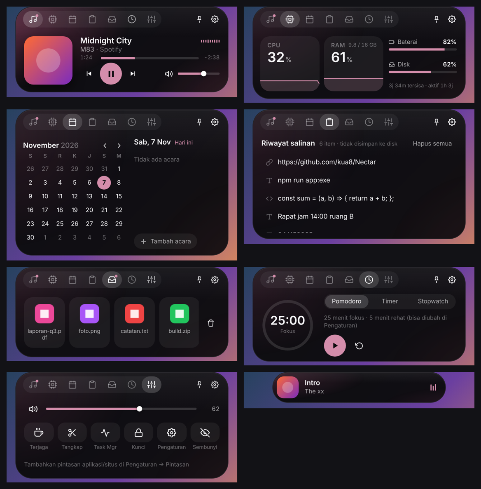
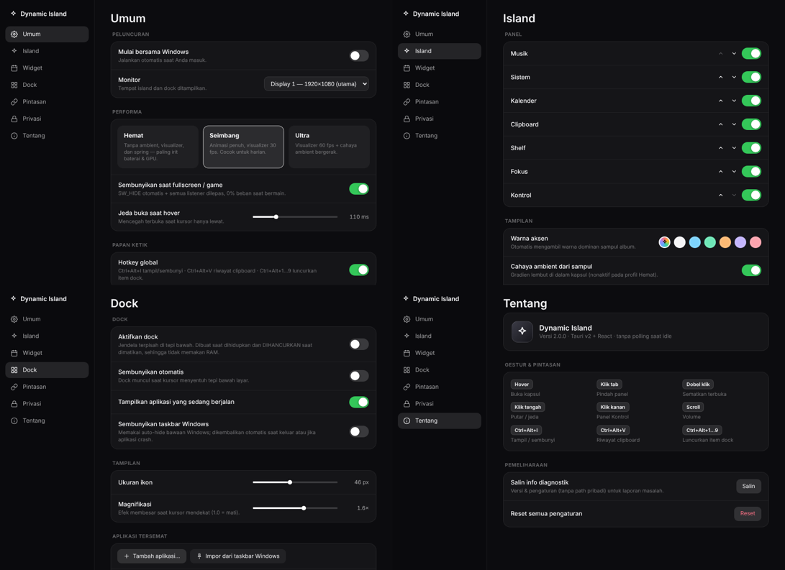

# Dynamic Island 2.0 — Windows 10/11 (Tauri v2 + React)

Island di tengah-atas layar + dock opsional + jendela Pengaturan. Dirancang **tanpa polling**:
semua hal digerakkan event Windows, sehingga CPU idle ≈ 0% dan otomatis menghilang saat game fullscreen.





> Pratinjau di atas dirender dari kode UI ini di Chromium headless dengan API Tauri ditiru (tanpa animasi spring).
> Bagian Rust/Win32 belum pernah saya kompilasi — lihat “Status verifikasi” di bawah.

## 1. Build jadi .exe

Prasyarat (sekali): Windows 10/11 x64 · Visual Studio Build Tools 2022 (workload **Desktop development with C++**) ·
Rust (`x86_64-pc-windows-msvc`, https://rustup.rs) · Node.js 18+ · WebView2 Runtime (sudah ada di Win 11).

```powershell
cd dynamic-island
build.bat                # atau manual:  npm install && npm run app:exe
```
Hasil: `src-tauri\target\release\dynamic-island.exe` (juga disalin ke `release\DynamicIsland.exe`).
Installer opsional: `npm run app:installer`. Mode dev: `npm run app:dev`.

Jika kompilasi `audio.rs` gagal di versi crate `windows` Anda:
`cd src-tauri && cargo build --release --no-default-features` (island tetap jalan; volume jadi no-op).

## 2. Fitur

**Island (7 panel, ganti lewat tab — tab bar tetap di atas sehingga kursor tidak “lepas”)**
| Panel | Isi |
|---|---|
| Musik | Album art, judul/artis/sumber, **progres + seek**, prev/play/next, volume, **visualizer dari peak audio nyata**, **cahaya ambient & warna aksen dari sampul** |
| Sistem | CPU & RAM + sparkline 60 dtk, baterai (mengisi/sisa waktu), disk, uptime |
| Kalender | Kalender bulanan, **agenda lokal + pengingat**, cuaca opsional (Open-Meteo) |
| Clipboard | Riwayat teks (hanya di memori), klik = **tempel langsung**, sematkan, hapus, abaikan data password manager |
| Shelf | Drop file dari Explorer, ikon asli, **seret keluar** ke chat/folder |
| Fokus | Pomodoro, timer (preset), stopwatch, cincin progres |
| Kontrol | Volume/mute, **Terjaga (keep-awake)**, tangkap layar, Task Manager, kunci, pintasan aplikasi/situs |

**Live activity (toast di kapsul):** lagu berganti · volume · charger terhubung/dilepas · baterai ≤20% · kamera/mikrofon mulai dipakai · timer selesai · pengingat agenda.
**Gestur:** hover buka · scroll = volume · klik tengah = putar/jeda · klik kanan = Kontrol · dobel klik = sematkan.
**Hotkey global:** `Ctrl+Alt+I` tampil/sembunyi · `Ctrl+Alt+V` clipboard · `Ctrl+Alt+1…9` luncurkan item dock.

**Dock (opsional, dibuat saat dinyalakan & dihancurkan saat dimatikan):** ikon asli, **magnifikasi** ala macOS, indikator aplikasi berjalan,
klik = aktifkan/luncurkan (berputar antar jendela), klik kanan = menu (jendela, tutup, lepas sematan), seret untuk urut ulang,
auto-hide, bounce saat peluncuran, impor dari taskbar Windows, opsi auto-hide taskbar Windows (dipulihkan otomatis saat keluar/crash).

**Pengaturan (jendela terpisah, 7 halaman):** monitor, profil performa (Hemat/Seimbang/Ultra), tab & urutan, aksen, notifikasi, cuaca, durasi fokus, dock, pintasan, privasi, diagnostik, reset, mulai bersama Windows.

## 3. Arsitektur performa

| Prinsip | Implementasi |
|---|---|
| Tanpa polling | Foreground/fullscreen → `SetWinEventHook` · media → event WinRT GSMTC · privasi → `RegNotifyChangeKeyValue` · clipboard → `AddClipboardFormatListener` · baterai → `RegisterPowerSettingNotification` · hotkey → `RegisterHotKey`. Semua thread tidur di `GetMessageW`/`recv()`/`WaitForMultipleObjects`. |
| Sampling hanya saat perlu | CPU/RAM hanya saat panel Sistem terbuka & kursor di atas; peak meter audio hanya saat panel Musik terbuka & lagu diputar (thread `park()` saat mati); daftar jendela dock hanya saat hover/foreground berganti. |
| Game Mode | Jendela depan menutupi monitor tujuan & tanpa `WS_CAPTION` → `SW_HIDE`, semua handler WinRT di-unsubscribe, meter dimatikan, React di-unmount. Tampil kembali ditunda 450 ms (anti-strobe). |
| Click-through | `SetWindowRgn` membatasi jendela ke bentuk kapsul — tanpa hook mouse. `WS_EX_NOACTIVATE`: klik tidak pernah mencuri fokus (kecuali saat mengetik acara, dilepas otomatis sesudahnya). |
| Animasi hemat GPU | Morph = Framer Motion `layout` (transform-only); cross-fade `opacity`; bar `scaleX`/`scaleY`; spring diganti tween di profil Hemat. |
| Memori | Dock & Pengaturan = jendela dinamis (dihancurkan saat tak dipakai), `EmptyWorkingSet` pada proses + WebView2 setelah idle 8 dtk, argumen WebView2 hemat, riwayat clipboard hanya di RAM. |

**Ekspektasi RAM jujur:** target < 25 MB tidak realistis untuk UI berbasis WebView2. Perkiraan idle setelah trim: ±40–80 MB total (island saja); dock/pengaturan menambah satu proses renderer selama terbuka.

## 4. Status verifikasi (jujur)

- ✅ **Frontend**: dibundel dengan esbuild, dirender di Chromium headless; diuji: wheel→volume, klik clipboard→paste, tambah agenda (+ pelepasan fokus), timer fokus, hotkey, Game Mode meng-unmount UI, tidak ada listener ganda, drop file, drag-out, magnifikasi dock, persist pengaturan.
- ⚠️ **Rust/Win32**: belum dikompilasi (sandbox saya Linux tanpa Rust). API `windows` 0.61 (WinRT & COM audio) paling berisiko — kirim pesan error kompilasi dan akan saya perbaiki.
- ⚠️ **Animasi spring nyata** dan perilaku `SetWindowRgn` + WebView2 transparan hanya bisa dipastikan di Windows Anda.

## 5. Dibandingkan Nectar (dari catatan rilis publik mereka)

Lebih lengkap di sini: clipboard manager, file shelf drag-out, visualizer audio nyata, ambient dari sampul, toast live activity, agenda+cuaca, suite fokus,
hotkey global, profil performa, arsitektur zero-polling + Game Mode anti-strobe.
**Belum menyamai**: mixer volume per-aplikasi, preview jendela (thumbnail) saat hover dock, dock sebagai pengganti penuh taskbar (tray/start button), sinkron kalender Google/Outlook, auto-update.

## 6. Catatan teknis

- `additionalBrowserArgs` di `tauri.conf.json` **harus identik** dengan `BROWSER_ARGS` di `src-tauri/src/wm.rs` (semua jendela berbagi satu environment WebView2).
- Styling utama memakai token CSS di `src/styles/*.css`; Tailwind tetap aktif (preflight + utilitas) untuk kustomisasi Anda.
- Pengaturan tersimpan di `localStorage` WebView2 dan disinkronkan antar jendela lewat event `storage`.
- Struktur: `src/island` (panel, hooks) · `src/dock` · `src/settings` · `src/shared` · `src-tauri/src/{hub,apps,icons,audio,wm,media,fullscreen,window,privacy,stats,trim,sys}.rs`.
- Pemecahan masalah: `link.exe` tidak ditemukan → pasang Build Tools C++. Game admin tidak menyembunyikan island → jalankan exe sebagai administrator. Kapsul hilang → tray → *Reset posisi* atau `Ctrl+Alt+I`.
